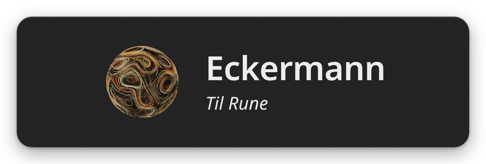

Fully local, cross-platform on-device speech-to-text, surpassing subscription-based cloud solutions in both accuracy and user experience, all without your data ever leaving your machine. Eckermann is tuned for natural language writing, designed first and foremost as an accessibility tool. 

Eckermann is as light as can be, and can run on most laptops. It uses about 1.4GB VRAM and 0.6GB RAM while the speech model is loaded, and under 2 CPU cores while transcribing. The model unloads after 10 minutes idle, at which point resource usage becomes negligible.

Language support remains limited to Danish. Open an issue and/or submit a PR if you'd like support for your language. Tested on Linux (Niri on Arch) only. 

## Credits

Eckermann runs on these models:

- [Edda v0.2](https://huggingface.co/danish-foundation-models/edda-v0.2) by the Alexandra Institute in the CoRal project, based on OpenAI's [Whisper large-v3-turbo](https://huggingface.co/openai/whisper-large-v3-turbo), for speech recognition.
- [Silero VAD](https://github.com/snakers4/silero-vad) for voice activity detection.
- [bert-punct-restoration-da](https://huggingface.co/Alvenir/bert-punct-restoration-da) by Alvenir, based on BotXO's [Danish BERT](https://huggingface.co/Maltehb/danish-bert-botxo), for punctuation and casing.
